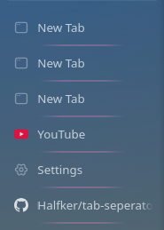
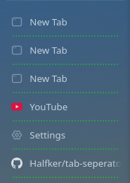
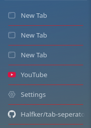
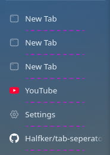
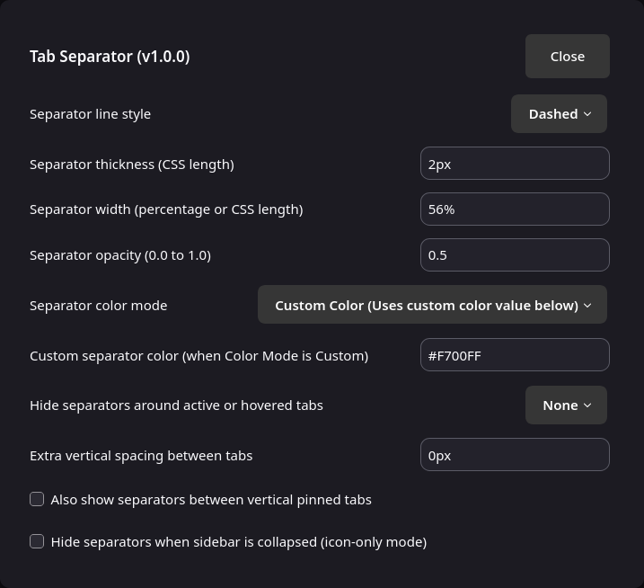

<div align="center">

# Tab Separator for Zen Browser

Customizable visual divider lines between vertical sidebar tabs in [Zen Browser](https://zen-browser.app/).

[](https://zen-browser.app/mods)
[](theme.json)
[](LICENSE)

<p align="center">
  
  &nbsp;
  
  &nbsp;
  
  &nbsp;
  
  &nbsp;
</p>

</div>

## Features

- **4 Line Styles**: Solid, Gradient (Faded Edges), Dashed, or Dotted.
- **Smart Active & Hover Hiding**: Automatically hides divider lines adjacent to the active tab and/or hovered tab.
- **Theme-Adaptive & Custom Colors**: Automatically adapts to light/dark themes (`currentColor`), Zen accent color (`--zen-primary-color`), native toolbar border colors, or any custom CSS color.
- **Customizable Dimensions**: Adjust thickness, horizontal width/inset, opacity, and extra vertical spacing between tabs.
- **Pinned Tabs & Compact Mode**: Optional toggles to show separators between vertical pinned tabs or hide them when the sidebar is collapsed.
- **Split-View Compatible**: Correctly handles Zen Browser split-view groups without extra lines between side-by-side tabs.

## Customization Options

Configurable in **Settings → Zen Mods → Tab Separator**:

<p align="center">
  
</p>

| Setting | Preference Key | Type | Default | Description |
| :--- | :--- | :---: | :---: | :--- |
| **Separator line style** | `mod.tab_separator.style` | Dropdown | `solid` | `solid`, `gradient`, `dashed`, or `dotted` |
| **Separator thickness** | `mod.tab_separator.thickness` | String | `1px` | Line thickness (`1px`, `1.5px`, `2px`) |
| **Separator width** | `mod.tab_separator.width` | String | `86%` | Horizontal width (`86%`, `100%`, `calc(100% - 16px)`) |
| **Separator opacity** | `mod.tab_separator.opacity` | String | `0.2` | Line opacity (`0.0` – `1.0`) |
| **Separator color mode** | `mod.tab_separator.color_mode` | Dropdown | `adaptive` | `adaptive`, `accent`, `toolbar`, or `custom` |
| **Custom separator color** | `mod.tab_separator.custom_color` | String | `#888888` | CSS color when color mode is `custom` |
| **Hide around active/hovered** | `mod.tab_separator.hide_around_active` | Dropdown | `both` | `both`, `active_only`, `hover_only`, or `none` |
| **Extra vertical spacing** | `mod.tab_separator.vertical_spacing` | String | `0px` | Extra vertical gap between tabs |
| **Show on pinned tabs** | `mod.tab_separator.show_on_pinned` | Checkbox | `false` | Show separators between vertical pinned tabs |
| **Hide in collapsed sidebar** | `mod.tab_separator.hide_in_collapsed` | Checkbox | `false` | Hide separators when sidebar is collapsed |

## Installation

### Method 1: Install via Sine (Recommended)

If you use [Sine](https://github.com/CosmoCreeper/Sine) mod manager:

1. Open **Settings → Sine** in Zen Browser.
2. Paste `Halfker/tab-seperator` into the custom mod input (or search for **Tab Separator** if available in the store) and click **Install**.
3. Configure options directly from the mod's settings panel.

---

### Method 2: Manual Installation (With Settings GUI)

1. Find your Zen profile directory:
   - In Zen Browser, open `about:support`.
   - Click **Open Folder** next to **Profile Folder** *(on Flatpak Linux: `~/.var/app/app.zen_browser.zen/.zen/<profile>/`)*.

2. Create the mod directory inside your profile:
   ```bash
   mkdir -p <Profile-Folder>/chrome/zen-themes/d4e8a912-6b3c-4f19-9a7e-2c8b5d0f3e1a
   ```
   Copy `chrome.css` and `preferences.json` into that folder:
   ```bash
   cp chrome.css preferences.json <Profile-Folder>/chrome/zen-themes/d4e8a912-6b3c-4f19-9a7e-2c8b5d0f3e1a/
   ```

3. Register the mod in `<Profile-Folder>/zen-themes.json`:
   ```json
   {
     "d4e8a912-6b3c-4f19-9a7e-2c8b5d0f3e1a": {
       "id": "d4e8a912-6b3c-4f19-9a7e-2c8b5d0f3e1a",
       "name": "Tab Separator",
       "description": "Customizable visual divider lines between tabs in Zen Browser's vertical sidebar.",
       "homepage": "https://github.com/Halfker/tab-seperator",
       "style": "chrome://zen-themes/d4e8a912-6b3c-4f19-9a7e-2c8b5d0f3e1a/chrome.css",
       "readme": "chrome://zen-themes/d4e8a912-6b3c-4f19-9a7e-2c8b5d0f3e1a/readme.md",
       "image": "img/img1.png",
       "preferences": "preferences.json",
       "author": "Halfker",
       "version": "1.0.0",
       "tags": ["tabs", "sidebar", "separator", "ui"],
       "createdAt": "2026-11-06",
       "updatedAt": "2026-11-08",
       "enabled": true
     }
   }
   ```

4. Add the import in `<Profile-Folder>/chrome/zen-themes.css`:
   ```css
   @import url("zen-themes/d4e8a912-6b3c-4f19-9a7e-2c8b5d0f3e1a/chrome.css");
   ```

5. Restart Zen Browser. Settings will appear under **Settings → Zen Mods**.

---

### Method 3: Quick Setup via `userChrome.css`

1. Open `about:support` in Zen Browser and open your **Profile Folder**.
2. Inside the `chrome` folder, copy `chrome.css` as `userChrome.css` (or add `@import url("chrome.css");` inside your existing `userChrome.css`).
3. Set `toolkit.legacyUserProfileCustomizations.stylesheets` to `true` in `about:config`.
4. Restart Zen Browser.

